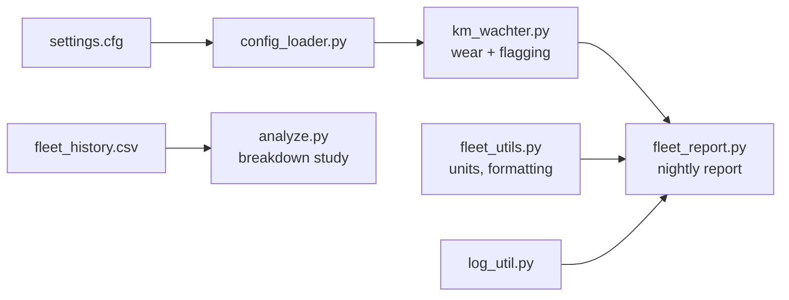

# KM-Wächter — Fleet Service-Interval Monitoring

KM-Wächter ("kilometre watcher") is a nightly batch service for a fleet of ~6,000 vehicles. For each car it computes service-interval wear from the distance driven since its last service, flags cars approaching their interval, and produces a fleet-health report for the operations team.

This repository contains the remediated version of a legacy (2013-era) codebase. It fixes four defects that silently corrupted the service's output, adds regression tests at the decision boundary, and includes a data-driven study of which vehicle attributes are associated with breakdowns.

---

## Architecture

| Component | Responsibility |
|---|---|
| `km_wachter.py` | Per-vehicle wear computation and service-due decision |
| `fleet_report.py` | Fleet-level aggregation (due count, mean wear, distance reporting) |
| `config_loader.py` | Parses `settings.cfg` (service interval, warning threshold) at runtime |
| `fleet_utils.py` / `log_util.py` | Unit conversion, formatting, logging |
| `analyze.py` | Group-wise comparison of broke-down vs. healthy vehicles |

**Decision rule** (unchanged): a vehicle is flagged when `wear = km_since_service / interval × 100` reaches the warning threshold, with `interval = 15,000 km` and `threshold = 80%`.

---

## Defects found and resolved

### 1. Quantized wear signal: early warnings could never fire
The wear ratio was computed with integer floor division. The output was therefore restricted to the discrete set {0, 100, 200, …}%, rather than a continuous percentage. Because 80% lies strictly between 0 and 100, the warning threshold could only be crossed after a vehicle had **already exhausted its full interval**. In effect, the early-warning system behaved as an overdue detector.

| km since service | Legacy output | Corrected | Flagged (≥80%) |
|---:|---:|---:|:---:|
| 11,850 | 0% | 79.0% | no |
| 12,000 | 0% | 80.0% | yes |
| 14,900 | 0% | 99.3% | yes |

### 2. Aggregate inherited the same truncation
Fleet mean wear went through the same integer arithmetic and reported **0.00%** on the reference sample, where the true value is **≈ 59.67%**. A dashboard figure of zero also hides the defect from anyone reading the report.

### 3. Missing telemetry crashed the batch run
Records without a `last_service_km` field caused an unhandled `KeyError`. For a single nightly batch, one malformed record halts reporting for the **entire fleet**. A missing reading carries different information from a reading of 0 km, so treating it as zero would be wrong too. The fix models absence explicitly (`None`): such vehicles are excluded from wear computation and aggregate statistics instead of being imputed.

### 4. Inverted unit-conversion constant
`MILES_PER_KM` held 1.609, which is the km-per-mile factor. Every distance reported in miles was inflated by a factor of 1.609² ≈ **2.59×**, so 100 km was reported as 160.9 miles instead of 62.1. No test covered this path. Corrected to `0.621371`.

### Secondary hardening
- Configuration parsing split on the first `=` only (`split("=", 1)`), so values containing `=` no longer break.
- File handles managed with context managers (`with open(...)`) to avoid leaked descriptors in long-running jobs.
- Identity comparisons (`is None`) replaced equality checks against singletons, and explicit `== True` was removed.
- Modernized to f-strings, type hints and docstrings, with no change in behaviour.

**Invariants preserved:** the service interval, the warning threshold (in code and `settings.cfg`), and the threshold comparison semantics. All changes correct how the rule is computed. None of them redefine the rule.

---

## Test strategy

Tests target the **decision boundary**, where a defect changes the operational outcome:

- **Boundary cases at 79%, 80% and 81%**, plus the 14,900 km case, with **hard-coded expected values**. Tests never recompute the formula under test, which would let a defect pass by agreeing with itself.
- **Missing-data regression:** a vehicle without `last_service_km` must not crash the report.
- **Acceptance suite** (`verify.py`): 11 end-to-end checks covering correctness, configuration invariants, unit conversion and robustness. **11/11 pass.**
- **CI:** GitHub Actions runs the test and acceptance suites on every push.

---

## Breakdown-risk analysis

A wear percentage measures how much of the service window a vehicle has consumed. It doesn't capture how hard the vehicle is being used. To test which attributes actually relate to failure, `analyze.py` uses `fleet_history.csv`: 120 vehicles with known outcomes, 26 of which broke down (21.7%).

**Method.** The data is split by outcome and each numeric attribute is compared between the two groups (mean and median). A deliberately simple, transparent comparison was chosen over a fitted model because n = 120 is too small to train and validate one reliably.

**Findings**
- **Total odometer and vehicle age** differ little between the groups. They seem to carry little signal, even though they are the attributes most often assumed to matter.
- **Distance since last service** separates the groups clearly: **≈ 11,677 km** for vehicles that broke down vs **≈ 7,261 km** for those that did not, about 61% higher.
- **Usage intensity** also differs between the groups, which suggests that load matters in addition to accumulated distance.

**Limitations.** With 26 positive cases, these are associations, not causal estimates. The group means have not been tested for statistical significance, and the sample may not represent the full fleet. The results indicate which signals to monitor. They do not amount to a validated predictive model.

---

---

Based on *The Legacy Fix*, a ProoV guided project.
**Hensi Patel** · [GitHub](https://github.com/Hp-132) · [LinkedIn](https://www.linkedin.com/in/hensi-patel-4111b3286/)
